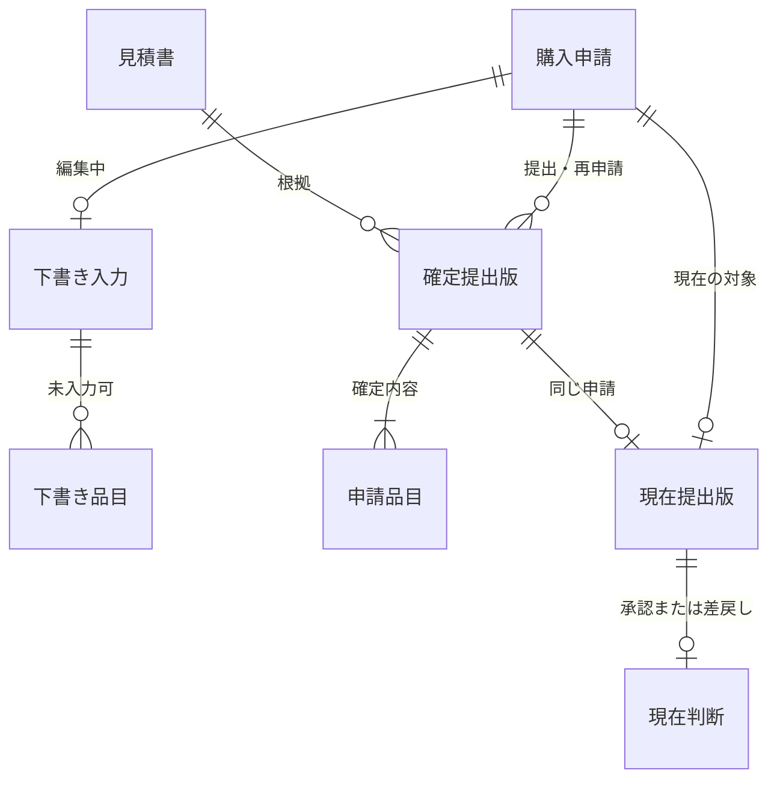
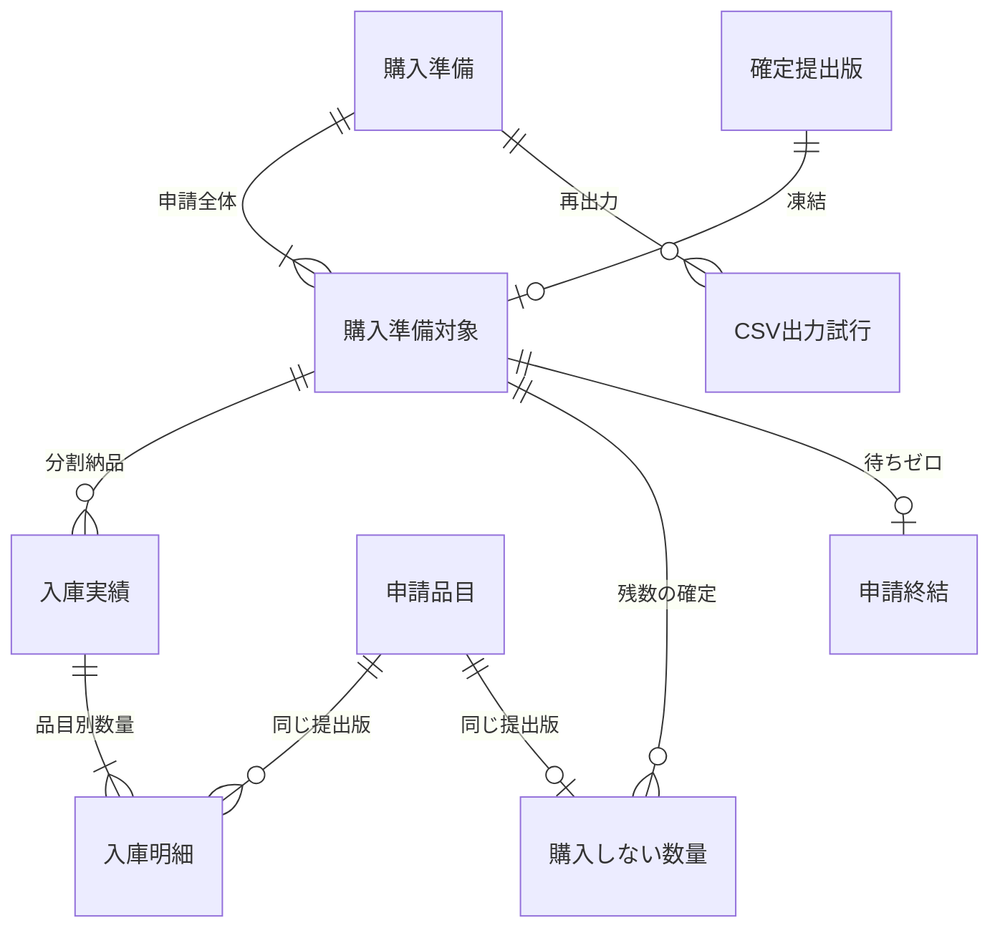

# 備品購入 — 論理モデル再検討案（人間レビュー用）

2026-10-20改稿。[中締めの合意](https://github.com/mk3008/alder/pull/254#issuecomment-6287161069)を基準とする候補。業務上の合意と、キー・記録の分割・更新制御の設計案を区別する。ObjectとEntityと物理Tableを1対1にしない。正式モデル記法・parser・DDLは未変更。

## 見直した構造

確定した希望、準備、実績、終結を別にする。代替品の記録経路と発注日を除き、見積書の根拠と分割入庫を加える。購入結果1件という旧制約は「申請全体の終結が最大1件」に適用し、入庫件数には適用しない。

### 提出まで

| 記録 | キー・参照の候補 | 項目・成立条件 | 作成・更新するActivity |
| --- | --- | --- | --- |
| 購入申請 | PK 申請ID | 申請者、進行状態。下書きでも識別できる | 備品購入を申請する／申請者 |
| 下書き入力 | PK/FK 申請ID | 入力途中の理由・見積参照等。未入力を許す。提出版の必須制約を流用しない | 申請する／再申請・破棄する、申請者 |
| 下書き品目 | PK 申請ID＋行番号、FK 下書き入力 | 品名・税抜単価・数量は入力途中を許す。0行も保存可能 | 同上 |
| 見積書 | PK 見積ID | 外部取得済み文書を特定・参照できる記録。文書本体または不変な版を特定する参照 | 申請する／再申請・破棄する時の取込み。取得は外部の購買担当者 |
| 確定提出版 | PK 申請ID＋版番号、FK 購入申請・見積ID | 購入理由、提出日時、申請時の権限判定根拠。見積書必須、内容は不変 | 申請する／再申請・破棄する、申請者 |
| 申請品目 | PK/FK 申請ID＋版番号＋品目番号 | 品名、税抜単価、依頼数量。提出版に1..N件。小計＝単価×数量 | 提出版と同時に確定 |
| 現在提出版 | PK/FK 申請ID、複合FK 申請ID＋版番号 → 確定提出版 | 初回提出前は記録なし。再申請成功時に同じ申請の新しい版へ切り替える | 申請する／再申請・破棄する |
| 現在判断 | PK/FK 申請ID、複合FK 申請ID＋版番号 → 現在提出版 | 承認／差戻しのどちらか、判断者、判断日時。差戻し時は理由必須 | 購入申請を承認する／承認者 |

現在提出版には複合参照を受けるための候補キー「申請ID＋版番号」を設ける案。現在判断の参照先変更は自動カスケードさせず、旧判断の削除または明示的無効化と版切替を同じ処理で行う。現在判断は申請あたり0..1件とし、承認と差戻しが同時に有効にならない。判断前には記録自体が存在しない。差戻し後の再申請成功では旧判断を無効化して現在版を切り替え、新しい判断待ちへ戻す。過去の承認判断を履歴として必須保存しない。確定提出版はその操作で書き換えない。

合計は提出版内の全品目の税抜小計の和として導出する案。権限判定根拠は外部基幹の従業員・役職・適用上限と判定時点を説明できる最小のスナップショットを候補とする。保存方法・保持期間はSR側で具体化し、従業員マスタを本システムへ新設しない。代理操作の可否をここから推定しない。

見積書は品目単位でなく提出する依頼全体に対応する。見積IDを申請間でUNIQUEにせず、同じ見積書を別申請者が使う経路を禁止しない。添付方式・ファイル形式・複数添付の上限は未決であり、見積IDは依頼の根拠文書のまとまりを指す論理案。差し替えで旧提出版の根拠が変わらないよう、不変な文書版を参照する。

### 準備から終結まで

| 記録 | キー・参照の候補 | 項目・成立条件 | 作成・更新するActivity |
| --- | --- | --- | --- |
| 購入準備 | PK 準備番号 | 確定日時、実行者。対象1..N件と同時確定 | 購入を準備する／購買担当者 |
| 購入準備対象 | PK 申請ID、FK 準備番号、複合FK 申請ID＋版番号 → 確定提出版 | 申請全体を一つの準備へ所属。参照版と出力内容を凍結 | 同上 |
| CSV出力試行 | PK 準備番号＋試行番号、FK 購入準備 | 試行日時、成否。成功した書き出し日時を区別 | 購入を準備する／購買担当者。履歴保持範囲は設計候補 |
| 入庫実績 | PK 申請ID＋入庫番号、複合FK 申請ID＋版番号 → 購入準備対象 | 登録作業者、登録日時、再送識別情報。申請に0..N件 | 購入結果を登録する／購買担当者 |
| 入庫明細 | PK 申請ID＋入庫番号＋品目番号、複合FK 入庫実績・申請品目 | 同一の準備済み提出版の品目と入庫数量。入庫1件に1..N明細 | 同上 |
| 購入しない数量 | PK 申請ID＋品目番号、複合FK 申請ID＋版番号 → 購入準備対象、複合FK 申請品目 | 申請者と調整して今後購入しないと確定した数量。0なら記録なしでもよい | 購入結果を登録する／購買担当者 |
| 申請終結 | PK/FK 申請ID → 購入準備対象 | 終結日時、登録者。全品目の待ちが0の場合だけ存在 | 同上 |

購入準備対象に候補キー「申請ID＋版番号」を追加。入庫実績の候補キーは「申請ID＋入庫番号＋版番号」。入庫明細の版番号は、実績ヘッダーと申請品目の双方へ複合FKで一致させる。購入しない数量も準備対象と同じ版を参照する。申請IDだけのFKでは別申請・旧版の品目混入を防げない。

申請終結は承認記録IDに属させない。申請IDそのものをPKにし、申請全体で一度だけ終結する。入庫0件でも全数量を購入しないと確定すれば終結できる。購入日時・実購入金額を終結の一律必須項目にせず、購入なしに架空の日時や金額を要求しない。

実購入金額の税区分・各回入庫との配賦・入庫日の業務上の粒度は未決。購入のある結果の金額・日時を不要と確定したわけではない。確定前に最終財務情報の具体的な格納・必須条件を決める必要があり、この数量モデルだけで実装仕様が完成したとは扱わない。登録日時と入庫日と発注日とを同一視しない。

## 関連図

## 数量と状態

品目ごとに、依頼数量 Q、入庫累計 R、購入しない確定数量 C、未入庫待ち W を区別する。

- W＝Q−R−C、R≧0、C≧0、W≧0。Wは導出し二重更新を避ける案。
- 申請全体の終結は、すべての品目でW＝0のときだけ許す。
- 全数入庫／一部入庫＋残り購入なし／全数購入なし、の3結果は数量から導出する。混合する複数品目にも適用する。
- 申請全体の合計だけで照合しない。Aを2個過剰入庫しBが2個不足でも、相殺して完了にしない。
- 入庫の2回目は最終結果の訂正ではない。待ちが残る途中段階への追記として認める。
- 終結後は入庫・購入しない数量・参照版の変更を禁止する案。終結後の訂正業務は今回扱わない。
- 状態表示は下書き／申請済み／承認済み／差戻しに加え、準備済みの作業中と終結を区別する案。正式な表示名は人間レビュー前。CSV成功を入庫・購入完了にしない。

## 制約と処理の責任

| 守る条件 | 宣言的な制約の候補 | 処理・運用で必要なこと |
| --- | --- | --- |
| 別申請・旧版の品目を使わない | 上記の複合PK/FK | 更新経路でも同一版を維持 |
| 申請は準備へ一度だけ所属 | 購入準備対象のPK 申請ID | 準備ヘッダー・対象・版を同時確定、空の準備を完成扱いしない |
| 現在判断は一つ | 現在判断のPK、判断区分のCHECK、差戻し理由の条件付き必須 | 再申請時の判断無効化・現在版切替を同時実行 |
| 古い承認で準備しない | FKだけでは不足 | 同じ申請を直列化して現在版・承認・準備未確定を再確認し、差戻しと準備の同時成功を防ぐ |
| 確定版・CSV再出力内容は不変 | FKだけでは不足 | 提出版・品目・見積文書版・準備対象を変更禁止。外部の可変マスタから再構成しない |
| 入庫・購入しない数量が依頼を超えない | 行単位の有効数量CHECK。精度・数値範囲は未決 | 同じ申請を直列化し、明細累計と購入しない数量を同時検証。集約を単純な行CHECKで保証したとしない |
| 待ちがある申請を終結しない | 終結のPKだけでは不足 | 全品目を再集計し終結。終結と入庫更新を同じ排他境界で制御 |
| 再送で入庫を増やさない | 操作の再送識別子のUNIQUE案 | 同一操作の再送と別の実納品を区別。別識別子で二重入力された同じ納品の検出はPK/FKだけでは不可能。現物と申請品目の一致も外部証憑・入力確認が必要 |
| 認証・権限・基幹参照 | 内部FKでは保証しない | SSO/基幹のSR契約・実行者権限を確認。外部障害で判定不能なら提出しない |

CSV再出力は外部の二重発注を防ぐ保証ではない。準備番号の利用契約・購買側の重複取込み対策は外部SR/運用で確認する。発注情報の追加受信は導入しない。

## 未決として残すこと

代理操作、破棄後の業務参照、再申請不成立後の編集中内容、入庫日・金額の粒度、理由・合意者の必須保存、出力試行履歴の保持範囲。現在判断の技術監査・権限判定根拠の保持期間もSRで具体化する。これらを追加ヒアリングの一括停止条件にせず、ラフを使って業務上の効果を確認する。

[再レビュー記録](logical-model-review-results.ja.md)に、正当例・反例・残る限界を示す。人間GUI採否・正式実装・DBでの強制検証は未実施。
