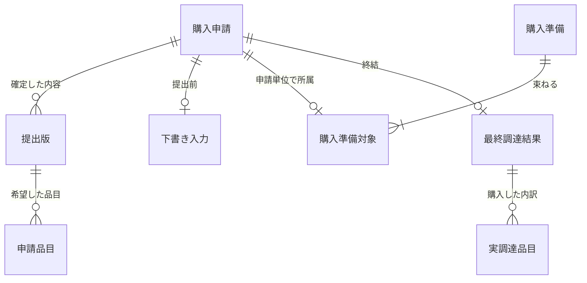

# 備品購入 — 論理モデル再検討案（人間レビュー用）

> [業務設計書の修正Draft](README.md)に追従する**論理的な候補モデル**。既存の操作可能な論理モデルGUIラフ・正式記法・parser・DDLを変更・承認する文書ではない。Alder Objectと論理Entity、物理テーブルを1対1にしない。

## なぜ旧モデルを見直すか

従来の「購入申請 → 提出内容 → 申請品目 → 承認記録／差戻し記録 → 購入結果」だけでは、**購入準備番号の確定、在庫不足による代替品・数量減少の合意、購入せずに業務を終了すること**を十分に表現できない。特に「承認された希望」と「調達可能で合意された内容」と「実際に購入した結果」は意味が違うため、単一の購入結果金額で上書きしてはならない。

## 表現したい業務上の事実（確認済み）

- 1件の購入申請は複数品目を持ち、各品目の税抜希望単価×数量を合計した額で役職別上限を判定する。
- 下書きは必須値が未入力でも保存できる。提出した内容は変更不能とし、再申請のたびに「何をFIXしたか」区別できる別版とする方向。
- 以前の承認判断の業務履歴を保持する必要はない。ただし**現在有効な承認**の有無は準備可否を左右し、過去の承認を誤って有効にしてはならない。
- 購入準備番号は**1回の準備で1つ**発行し、複数の購入申請を紐付ける。今回は1申請を複数準備番号に分割しない。確定後は差戻し不可。CSV生成に失敗しても準備の確定を取り消さず、同番号・同内容で再出力する。
- 在庫不足では申請者と相談して代替品、希望数量の減少、全量購入断念等の結末を選び、**何らかの形でクローズする**。これは承認時の希望内容の訂正ではない。
- 複数日に分けて残数を購入する「分割購入」は今回扱わない。一度の最終調達結果を申請単位で確定し、登録後の訂正業務は扱わない。

## 暫定的な関連図（候補）

この図は、関連の大枠を示すだけであり、図中の0..Nが業務上すべて自由であるという意味ではない。下書きの入力途中の品目、多重度の下限、準備の対象数、提出版と現在有効な承認との対応は、別の条件が必要である。調達合意の過程はまだ独立Entityとして確定していない。

## 識別と関係の候補

| 論理上の記録 | 識別の候補 | 重要な関連と検証 |
| --- | --- | --- |
| 購入申請 | 購入申請ID | 申請者と一件の業務を識別。下書き、提出版、現在有効な判断、準備・結果がこの一件に関係する |
| 提出版 | 提出版ID（購入申請IDとの対応は必須） | **確定時点の希望内容を変更しない**。同一申請の別版を区別。準備・承認がどの版に依存するかを明確にする |
| 申請品目 | 提出版ID＋品目番号等 | 税抜希望単価・数量。小計は単価×数量。実際に調達した品目で上書きしない |
| 下書き入力 | 下書きの識別は未採用 | 必須値の欠落を許す。確定した提出版と同じ制約で保存できると仮定しない |
| 現在有効な審査判断 | 購入申請／提出版に紐付く候補 | **承認と差戻しの同時有効を禁止**。旧承認の履歴は業務上不要。履歴を残す技術監査は別 |
| 購入準備 | 購入準備番号 | 一回の準備を識別し、対象申請の確定と原子的に成立。CSV出力試行とは別 |
| 購入準備対象 | 購入準備番号＋購入申請ID等 | 準備1件に申請複数。**同一購入申請が別準備に二重所属しない**。どの確定版かが再出力時も変わらない |
| 最終調達結果 | 購入申請IDを一意に参照する候補 | 申請あたり**最大1件**。希望どおり／代替・減数で購入／購入なしで終了を区別する。結果訂正不可 |
| 実調達品目 | 最終調達結果＋内訳番号等 | 実際に購入した商品・数量・金額。代替品と元の希望品目の対応方法は未決。購入なし終了なら実購入行は存在しない |

**重要：** 旧モデルの `購入結果ID(PK) → 承認記録ID(FK)` は、別の承認記録を経由して同じ申請に複数結果を作れてしまう。今回の上限は「承認記録単位」ではなく**購入申請単位**のため、その単位で一意性が成立する必要がある。一方、結果1件は実調達品目が1件だけであることを意味しない。

## 今回の追加業務で検証すべき反例

| 入力例 | 期待する業務上の意味 | モデルでの問題・保証 |
| --- | --- | --- |
| 椅子10個を承認、在庫5個で申請者が5個だけを了承 | 希望10はFIXした版に保持、実購入5と残り不要の結末を別に表現 | 確定申請品目を5にUPDATEしない。購入済み判定とクローズを説明できる |
| 椅子がないため、申請者が別メーカー品へ変更を了承 | 希望品と実調達した代替品が別である | 元の品名を代替品に上書きしない。承認再取得の要否は未決 |
| 全品目在庫なし、代替もなく申請者が不要と回答 | **購入実績0で申請がクローズする** | 購入日時・実購入金額の非存在を表現し、「購入済み」と誤表示しない |
| P-001で準備確定後、CSV出力に失敗 | P-001の準備対象を保持し、同内容で再出力 | CSV失敗が差戻しを復活させない。二重の準備確定や内容変更を防ぐ |
| 同じ購入申請を結果登録2回 | 最終的な結果は1件まで | 構造の一意性・DBトランザクション・再実行時の重複判定で防ぐ。ユーザーへ「失敗後に再登録してよいか」と質問しない |
| 別版を再申請したのに、古い提出版の承認で準備確定 | 不正 | **現在有効な提出版と判断の対応**を確認し、古い承認を根拠にしない |

## 未決事項（設計者が勝手に確定しない）

- **代替品や希望数量・金額の変更を、申請者の合意だけで処理できるか、元の承認者の再承認が必要か**。増額・内容変更が決裁基準に影響したときの扱いも含め、強く関連する質問をまとめて確認する。
- **調達調整の会話・合意を、システムへどの単位で記録・照合する必要があるか**。対面やメール等の交渉手段を勝手にシステムへ取り込まない。
- **実調達結果の金額・日時・代替品対応と、購入なしで終了した場合の記録内容**。結果は申請単位1件でも、明細の粒度や最終状態の名前は未採用。
- 代理申請、破棄・再申請失敗後の情報の扱い、外部基幹システムのSR、下書きの保存先の詳細は、既存の残問と別に管理する。

## 更新方法に関する方針

対面の質問ごとにこの表・Mermaid・BD全体を更新して待たせるのではなく、短い回答メモを蓄積し、中締めでまとめて改稿する。人間が業務上の制約をレビューしてからGUIラフ・正式モデル記法・parser・Check/Skillへ進む。[対面ヒアリングと中締めのナレッジ](https://github.com/mk3008/root/blob/main/knowledge/business-design-interview-cadence.md)を参照。
