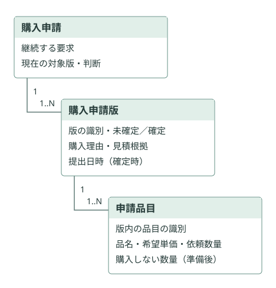
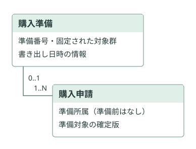
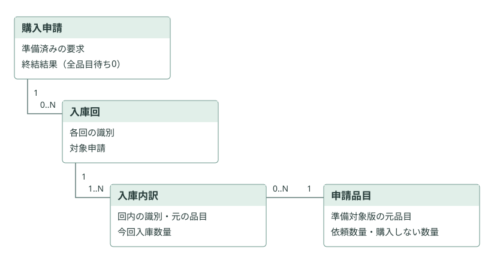

# 購買業務の構造モデル — 新規草案

購入申請・購入申請版・申請品目を中心に、購入準備・入庫回・入庫内訳を加える**6つの業務概念**を提案する。現在判断、購入しない数量、終結は、それぞれを使う対象の条件付き情報として表す。エンティティ数の最小化ではなく、依頼内容・判断対象・各回の入庫を取り違えず説明できることを優先する。

人間レビュー前の候補。属性のまとまりは物理的な列やテーブルを指定しない。図の線は業務上の関連であり、キー、DB製品、アーキテクチャ、ライブラリを規定しない。

- [モデルと情報の存在条件](model.ja.md)
- [工程ごとの操作・状態遷移](activities.ja.md)
- [正当例・反例と必要十分性の点検](review.ja.md)
- [旧モデルとの比較・判断と質問・Skill化への知見](comparison-and-learning.ja.md)
- [根拠と検証範囲](evidence.ja.md)

## 申請内容のまとまり

版は未確定でも存在する。提出でその内容を確定し、確定済みの内容は変えない。再申請は別の版を確定する。見積書は版の根拠情報とし、提出時に必須、下書きでは未入力を許す。

## 準備のまとまり

購入準備は複数の申請をまとめて識別する。申請ごとに準備対象の確定版を区別し、番号・対象・内容を固定する。CSV再出力は同じ準備の情報を使う。

## 入庫のまとまり

入庫回は申請ごとの各回の入庫、内訳はその回に入庫した元の申請品目と数量を表す。全数購入なしなら入庫回は0件のまま終結できる。購入しない確定数量は元の依頼数量を変更せず、品目に保持する。

人間に確認したい中心点は、①この6概念で業務を追えるか、②現在判断・終結を条件付き情報にまとめても不足がないか、③入庫の「回」と「品目別内訳」を分ける意味があるか、の3点。[未決と質問](comparison-and-learning.ja.md#人間へ返す判断と質問)は業務条件の変更を自動的に確定しない。
