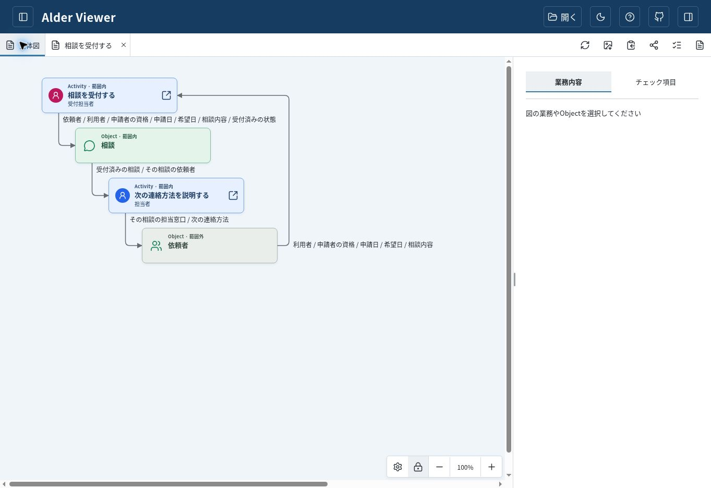
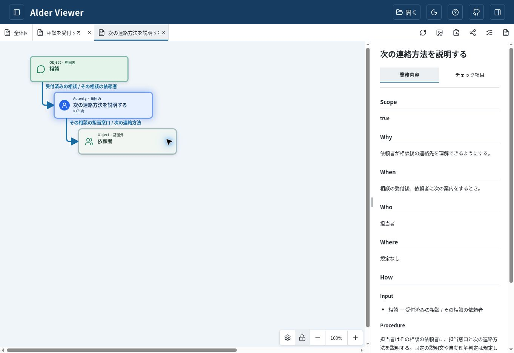

# 相談受付の書式移行と最終修正

[移行後の業務設計書](https://github.com/mk3008/alder/blob/e8d808902641d4571bbc5656b4b23d9e959f7636/work/check-item-examples/fixtures/README.md) ／ [Viewerへ入力する固定raw URL](https://raw.githubusercontent.com/mk3008/alder/e8d808902641d4571bbc5656b4b23d9e959f7636/work/check-item-examples/fixtures/README.md)

[現行Alder Viewer](https://mk3008.github.io/alder/)の「URLを開く」へ上記raw URLを入力すると、全体図から「相談を受付する」「次の連絡方法を説明する」の詳細を開ける。今回、実際にその操作を行い、2 Activity・2 Object・4本の情報の受け渡しと両Activity本文を確認した。Viewer本体とCheck Viewerの実装は変更していない。

相談Checkの最新版は[初稿修正候補02](initial-candidate-02.md)と[既存4 ID更新候補01](update-candidate-01.md)。過去の4ケースの生成・読取・hashは[前回の比較](../meaning-validation-20261018/README.md)に残し、新しいBDで過去から実行済みだったことにはしない。

## 2点の修正と追加の再読取

- 必要条件・十分条件・直接期待結果・未決の意味の区別は維持し、自然言語でよいことと、式は誤読防止に役立つ場合だけ使うことをcanonical guidanceとCheck Skillに統一した。既存の一般保証、購買の必須入力と正常結果の区別は変更していない。新しい規則の追加ではなく、一律に必要条件式を求めた2文の置換。
- CI-02は、表にある停止中の行と、表にはない「本人・14日・非停止で他条件同一」の仮定を一般則から導く比較と明記した。対照行やCheckは増やしていない。[前回readerのNG](../meaning-validation-20261018/initial/reader-report-03.md)と[反実仮想なら必須NGではないとの評価](../meaning-validation-20261018/initial/finding-adjudication.md)は変更していない。
- 別readerの読取で、初稿CI-06の前提「その依頼者へ案内」が正しい宛先を先取りする問題も検出。作者が初稿候補01を残し、候補02で前提だけ「その相談について案内」へ修復した。正しい依頼者へ二内容を説明する結果保証と誤宛先の例、ID・未レビュー状態は不変。業務上の新判断ではない。

[作者点検・差分](author-check.md)と[作者実行・入力hash・依頼全文](author-execution.md)を参照。統括は生成物を手編集せず、今回の指定を受けた限定修正として扱う。新しい初稿生成の成功や完全な自律検出の実証ではない。旧Checkからの差分は、初稿のCI-02文・CI-06の前提句とBD版リンク、更新のBD版リンクだけと[機械照合](check-regression.json)した。旧ID/人間状態・表の行・根拠ラベル・Test記述を保持し、ローカル参照は初稿50件、更新33件が解決した。

## 読取・作者修復の記録

[最初のreader所見と修復後の再読取](check-reader.md) → [作者の採否・修復](author-check.md) → [最終保存版への独立読取](final-check-reader.md)。最終readerは両候補を全限定スコープで読み、根拠付きNGなしと報告した。BD自体の未決と任意改善を合格判定に混ぜていない。最終readerとBD差分readerにはrootから `gpt-6-sol / medium / fork none` を明示要求した。作者が呼んだ最初の子readerはfork noneでモデル/effort overrideなしのため、明示設定を確認した最終readerとは区別する。いずれも実効runtimeの独立attestationはない。

ホストは公開68af49dの初稿候補02をGitHub Previewで読み、CI-02の表外対照の明記と一般則へのリンク、CI-06の前提/結果の表現を確認した。表示点検を新しい業務意味への人間承認とは扱わない。

## 旧BDと新BDの意味対応

| 旧記述 | 移行後 | 保持・明示したこと |
| --- | --- | --- |
| 冒頭の業務上の規則 | 同じ冒頭本文 | 暦日差0〜30日両端、本人または委任済み代理人（両資格可）、登録済み/非停止、条件外の応答/記録/再申請と希望日変更の未決を同一本文で保持 |
| 2 ActivityのWhy/When/Who/Result | 同名の正式欄 | 両Activity名と各欄本文は文字列で同一 |
| 受付How | Input/Procedure/Output | 依頼者から受け取る相談情報、受付条件の確認、同じ相談が受付済みになることを分配 |
| 案内How | Procedureと依頼者へのOutput | その相談の依頼者への担当窓口と次の連絡方法、固定説明文/自動理解判定を規定しない原文を保持 |
| 原典に含まれる依頼者と相談 | 2 Object、Information、Scope、4関連線 | 依頼者は外部の相手(false)、相談はこの業務で成立する情報(true)。DB/台帳/クラスの新設や永続保存方式ではない |
| 場所・環境条件なし | 各Where「規定なし」 | 新しいチャネルや画面操作の要求を導入しない |

Objectの責務分類は書式移行に伴う明示である。利用者の登録・停止管理までこの業務の責務と解釈せず、別の管理Objectや独立Activityを推測追加しなかった。依頼者から受け取った情報と同一相談の対応を、既存の受付→案内の受け渡しとして表す。新しい通知・拒否・回復・本人認証方式や承認方針は決めない。[原典比較の記録](migration-checks.json)と[別読者の移行レビュー](migration-reader.md)を参照。構文成功を業務合意や完全性の証明とは扱わない。

旧固定URL `d7f84fcca636e88015b15b9da993b200abd62999` はGitHubから再取得し、旧入力本文と一致した。新固定rawの取得本文も作業版と一致。過去のsnapshot/入力/評価/hashは不変。過去Checkの根拠を一括repinせず、今回作った2つの候補だけを新BDへ追従させた。`## 業務上の規則`、両ActivityのアンカーとWhen/How/Resultは存続し、古い行番号を新しい版へ持ち越していない。

## 検証と表示

- 公開canonical/BD版：`e8d808902641d4571bbc5656b4b23d9e959f7636`。公開同期bundle：`ee99fd399a520abf7ba52f113f17d3c7dc090846`。作者/readerが使ったworking fileと公開版の一致は統括が別途[11ファイルで確認](execution-version.json)。個々のreaderが遠隔照合したと過大に報告しない。
- 関連Python suite：92 tests成功（以前の91を維持し、式の任意性の配布契約1件を追加）。Business Graph suite：54 tests成功（2 Activity/2 Object/4関連線と未決/境界保持のfixture回帰2件を追加）。既存のActivity名診断の正例/反例を維持。指示の文字列検査は実生成の正しさを証明しない。
- Skill基本検証成功。公式reference exporterは3 Skill/13ファイルを再現。公開済みcanonicalからbundleを生成し、旧provenanceを装って手コピーしていない。
- repository Business Graph exporter/validatorとinstalled plugin 0.4.6の同梱exporterで出力一致。installed exporter authorityは `1e76b958deb8594f66f3184dc644ef68c9235d38`、script SHA-256 `4f5cf06d2c3795cded69ab751110a11807ea580586b12805e06e175ecd60a9ed`。旧fixtureの構造エラーも確認した。[新しい投影JSON](graph.generated.json)は検証用出力であり、編集する第二仕様ではない。
- 現行main `fb13c2fbc0f1bf0d702a4b4bccd3de303c80d7f2` の `web-viewer/src/graph.ts` を変更せず取得し、実 `parseDesign`/`validateGraph`をNodeで実行。exporter出力とのdeep equality、両Activityの順序と本文を確認。[再実行スクリプト](current-parser-check.mjs)はparser/BD/JSONを引数で渡す。
- 現行本番サイト `https://mk3008.github.io/alder/` の「URLを開く」から、新固定raw URLを入力して読込。全体図の2 Activity/2 Object/4線と正式名、両Activityの詳細タブ、右側MarkdownのWhen/Input/Procedure/Output/Resultを実閲覧した。チェックリスト読込は実施しておらず、Check Viewer互換性は主張しない。観測はこの時点の本番画面で、配信bundleのcommit attestationや全端末幅の検証ではない。

受付Activity詳細も画面とアクセシビリティ本文で確認したが、そのスクリーンショットの共有先同期は確認できず未添付。上記2枚は同期済みの実物を保存した。画面の初回応答に長い待ちがあり、性能測定値とは扱わない。

Git CLI pushは認証情報を取得できず失敗し、未公開local commitは公開版の証拠から除外。認可済みGitHub connectorで対象branchへsource/bundleを公開して再取得した。検査スクリプト初版は状態を含む行全体（冒頭版リンクも含む）を比較して失敗したため、状態値と版追従後の根拠行に分けて再検証した。製品テストのassertを弱めた変更ではない。

最終CIと固定headはPR返却コメントに記録する。最終候補への独立Chatレビューと本人の採用判断、merge/tag/release承認は残る。Draft維持、Viewer/Check Viewer/PR #240・他Issueの実装変更なし。
