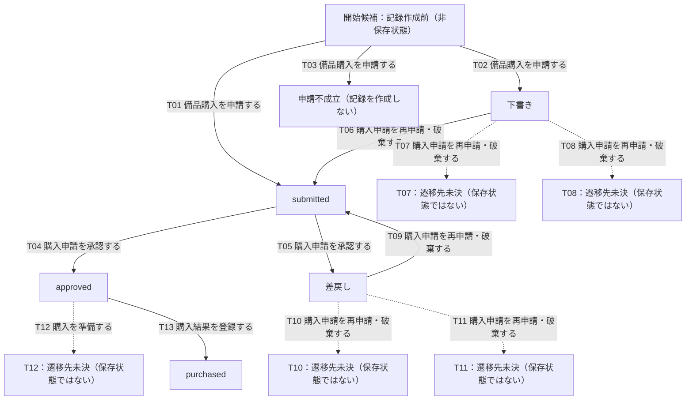

# 宣言から生成した状態遷移

部分定義。未記載の操作は未決。終端は未決。条件の真偽・業務整合性は判定しない。

| ID | 遷移元 | 操作・条件 | 遷移先 | 明示効果 | 根拠 | 注記 |
| --- | --- | --- | --- | --- | --- | --- |
| T01 | @new | 備品購入を申請する：必須情報を入力し役職別上限額へ適合と自動判定 | submitted | change | E1 | 新規作成 |
| T02 | @new | 備品購入を申請する：提出前に中断し下書き保存を選択 | 下書き | change | E2 | 必須項目が未入力でも保存可能 |
| T03 | @new | 備品購入を申請する：役職別上限額に不適合または判定不能 | @none | no-create | E2 | submittedを作成しない。下書き保存の選択とは別条件 |
| T04 | submitted | 購入申請を承認する：承認者が購入を認める | approved | change | E3 | 承認日時を記録 |
| T05 | submitted | 購入申請を承認する：承認者が購入を認めない | 差戻し | change | E4 | 理由と日時を記録 |
| T06 | 下書き | 購入申請を再申請・破棄する：再申請を選択し必須情報と役職別上限額適合を確認 | submitted | change | E5 | 同じ対象を再申請 |
| T07 | 下書き | 購入申請を再申請・破棄する：破棄を選択 | @unknown | constraint | E6 | 以後の承認・購入対象外。保存状態・物理削除・履歴は未決 |
| T08 | 下書き | 購入申請を再申請・破棄する：再申請時に役職別上限額へ不適合または判定不能 | @unknown | constraint | E6 | submittedへ変更しない。元の状態・内容の扱いは未決 |
| T09 | 差戻し | 購入申請を再申請・破棄する：再申請を選択し必須情報と役職別上限額適合を確認 | submitted | change | E5 | 同じ対象を再申請 |
| T10 | 差戻し | 購入申請を再申請・破棄する：破棄を選択 | @unknown | constraint | E6 | 以後の承認・購入対象外。保存状態・物理削除・履歴は未決 |
| T11 | 差戻し | 購入申請を再申請・破棄する：再申請時に役職別上限額へ不適合または判定不能 | @unknown | constraint | E6 | submittedへ変更しない。元の状態・内容の扱いは未決 |
| T12 | approved | 購入を準備する：対象を選択しCSV出力 | @unknown | constraint | E7 | purchasedへ変更しない。不変の明示宣言は未追加 |
| T13 | approved | 購入結果を登録する：外部購入完了後に対象を選択し実購入金額と購入日時を記録 | purchased | change | E8 | 購入日時を登録時刻と同一視しない |
