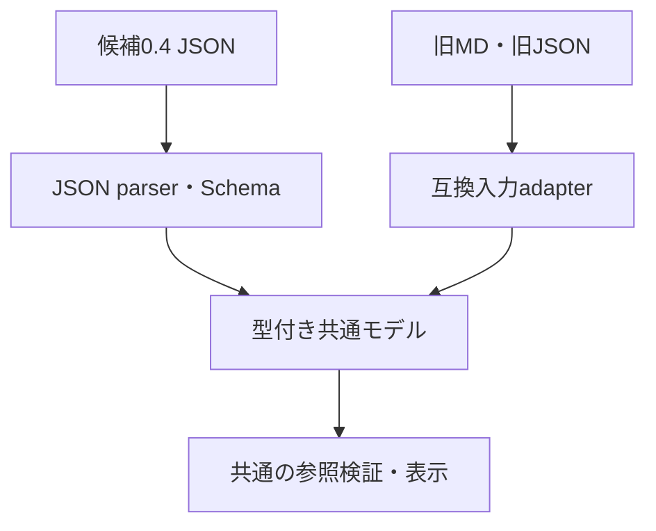

# JSONの業務参照をMD構文から独立させる

Control root #144、Execution #274、関連 #275、Draft PR #285。同じ作業系列の基準headは `1a3de05851012f3a071f75a2bac86d99e2aae220`。今回はコード量・処理経路・依存範囲と保証を評価し、無関係なCI高速化や速度測定を成果にしない。

## 変更前の依存

JSONのvalidatorと状態panelが、Activity.exceptionを `- **例外名** — 説明` として解釈していた。状態遷移には例外名だけを保持し、構造参照が表示文に依存した。json-documentもMD adapterを直接importしていた。後段のrendererを一つにしただけで、JSONの業務意味をMDの記法から独立させていなかった。

## 変更後の依存

- BD候補0.3に `exceptions[{id, activityId, name, description}]`。状態候補0.2は `exceptionId` を参照し、外側候補0.4で組み合わせる。Check payloadは0.1を維持。
- 同じ名前の例外を別Activityに置ける。ID・所有Activity・原典版を検査し、文章の装飾・改行・箇条書きは参照に影響しない。
- JSON専用moduleのimport closureから旧MD業務parser／adapterを排除。混合入力の識別だけをdocument-inputへ置く。Markdown文章の表示は構造導出に使わない。
- 旧JSON 0.1〜0.3の名前解決は版付き互換境界だけで行う。旧MDは入力adapterでだけ解釈し、変換後の参照検査もJSONと同じvalidateReferencesを使う。
- 状態rendererに残っていた未使用のMD表parserと、表示段階のMD例外抽出を削除。共有参照検証と重複したViewerローカル検査も除去。
- JSONの名前をMDの区切り記号へ合わせる制約を新形式から除去。Graph v1 exportは独立契約のまま、表現できない名前を明示拒否する。描画算法・座標・配線・余白・CSSは変更しない。

## 互換境界と保存

読込時は旧JSONの原文・元revision・既存UUID、旧MDの原文・名称IDを保持する。派生モデルだけを新しい構造へ投影し、自動保存移行しない。旧名前参照が存在しない・曖昧なら拒否し、参照のない旧例外はnullと診断を保持する。未知版は拒否する。

旧形式に対する低水準core.validateは構造／型付き参照と互換検査が必要な診断を返す。名前参照を含む旧版の完全な受入はreadLegacyPackageで行い、CLIも旧版の場合だけこの境界を通す。新しい0.4 JSONから旧構文を解釈する経路はない。

明示的なprepare-exception-upgradeは元ファイルを残し、新package／変更文書revision、従属basedOnを更新した候補だけを作る。既存ID、source情報、Checkレビュー状態と未決を維持する。保存commitでは既存の期待hash／版とmigration指定、人間合意ゲートが働く。構造移行から承認を推定しない。

## 独立した検証

`independent.json` はMD parser／converterを使わず手書きの識別子と期待業務を定めた合成入力。2操作T01/T02、Activity activity-receive、例外exception-receiveを独立期待値とする。同名の別Activity例外は別IDで区別する。

- Node実CLI：旧MD／変換moduleのresolveを拒否し、Pythonも利用不可にして0.4のcreate／inspect／commit／validateを実行。
- Viewer：旧MD業務moduleのimportを拒否してJSON parser・業務詳細・Check・状態UIを実際にbundleし、DOM表示・参照先移動を検証。
- 入力分岐：実MD adapterへ観測counterを付けたbundleで、新JSONでは呼ばれず、MD入力時だけ呼ばれることを確認。
- 書式変更：説明文・補足の装飾／改行／箇条書きが変わっても例外IDと状態SVGが不変。
- 負例：未知／重複／別Activity ID、所有Activityの差替え、原典revision・構造版違い、正常経路の例外参照、不明例外の無診断を拒否。
- Plugin：Repositoryなしの同梱コピーから旧MD関連moduleを物理的に除去して新JSONの保存／更新／検証を実行。
- Chrome：既存jsonStates群に0.4の状態表示・説明書式差・保存復元・不正ID時の表示保持を追加。最終全47群と既存の図／Check／余白回帰を維持する。

## セルフレビューと追加修正

1. 正規表現の移動だけではなく、保存契約を例外要素＋ID参照へ変更し、新形式validator／rendererから文章抽出を除いた。
2. importの独立性を口頭で済ませず、禁止moduleを解決できない条件で実CLI／bundleを動かす負例を追加した。
3. MD変換後にも独自の参照検査が残る不足を確認し、共通validateReferencesへ接続した。その際、旧MDの未解決Findingを解決済みIDと分離して保持するadapter不備を修正した。既存手書き期待値で確認する。
4. 入力予算の移動で旧JSON経路がサイズ／要素制限を迂回しないよう、互換変換前と共通JSON入口で予算を検査する。
5. 新形式の表示名に残る旧MD delimiter制約を切り分け、Graph v1の独立したexport境界へ残した。
6. 例外の改名はID維持、別Activityへの移動は同じIDのまま暗黙変更しない。直接編集APIとauthoring guardを整合させた。
7. Plugin guide／同梱validator／provenanceを同じ公開済みcanonical sourceへ揃え、隔離コピーでも確認する。BループSkill新設・追加LLM試験は行わない。

最終CI・Plugin bundle source commit・未検証範囲はAlder #274とroot #144への返却に記録する。本人の実操作採否、形式の正式v1採用、main merge、Plugin release、本番配信は実施しない。
